<p align="center">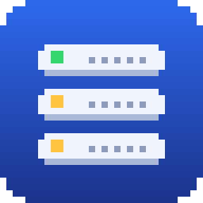</p>
<h1 align="center">BlockHost</h1>
<p align="center"><b>Run your own Minecraft Java server on Windows, without the technical stuff.</b><br>
Start and stop, add mods and plugins, invite friends, back up your world, see the map, and ask an AI when something breaks.</p>

<p align="center"><a href="https://github.com/grigorehunduu-droid/blockhost/releases/latest"><b>Download BlockHost for Windows</b></a></p>

<p align="center">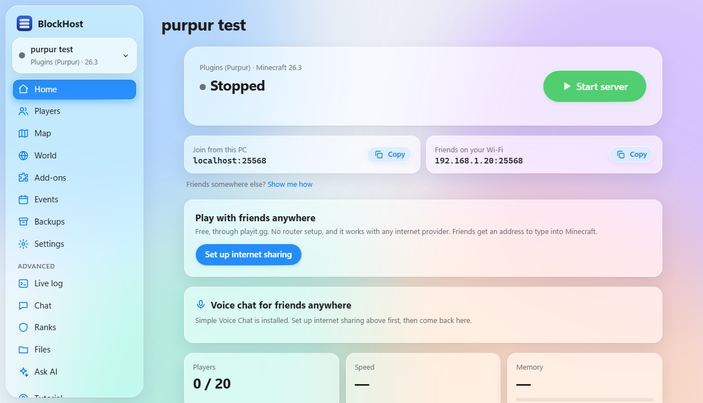</p>

> NOT AN OFFICIAL MINECRAFT PRODUCT. NOT APPROVED BY OR ASSOCIATED WITH MOJANG OR MICROSOFT.

## What it does

- **One-click servers** – Vanilla, Paper, Purpur, Fabric, Forge and NeoForge, any version. Java is downloaded for you.
- **Add-ons** – search Modrinth or CurseForge and press Install; required libraries come along. Or drop in a `.jar`.
- **Play with friends** – copy the address for friends on your Wi‑Fi, or share over the internet through playit.gg with no router setup.
- **Players** – admins, kicks, bans, whitelist, game modes, and a look inside anyone's inventory and ender chest.
- **Live map** – a top-down map of your world with dots for online players, plus an optional BlueMap 3D view.
- **Backups** – one click or on a schedule, checked after they are made, restored in one click.
- **World tools** – test a seed on a hidden throwaway world and see what is near spawn, start a new world (the old one is kept), and pre-generate land with Chunky.
- **Events and phone alerts** – run commands at a set time (drop parties, contests, reminders), and get a message on your phone through the free ntfy app when the server crashes or a friend joins.
- **Ranks** – LuckPerms ranks and permissions with switches instead of commands.
- **Problems in plain words** – Home lists trouble found in the log and how to fix it.
- **Ask AI** – connect Gemini (free tier), Claude or ChatGPT to explain crashes, or describe a server ("a chill Fabric server for 4 friends") and let it pick the version and mods. Nothing runs or installs until you approve it.
- **Everything else** – live log and console, chat, server settings in plain words, a file editor, performance charts, auto-restart after crashes, daily restarts with warnings, one-click voice chat setup, a tray icon that keeps running servers going, and a short animated tutorial.
- **Liquid Glass look** – light and dark mode, glass that bends what is behind it, and calm animations (off when Windows "reduce motion" is on).

<table>
<tr><td>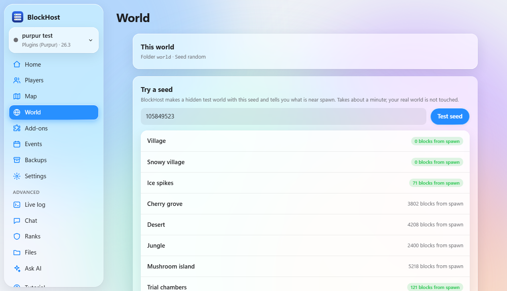</td><td>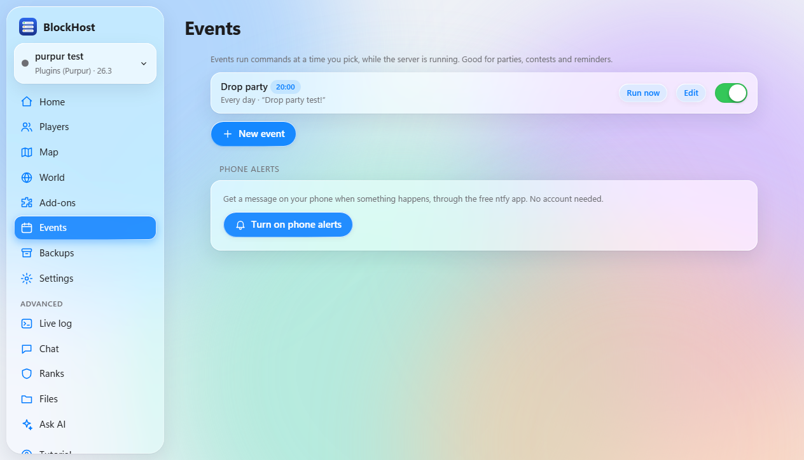</td></tr>
<tr><td>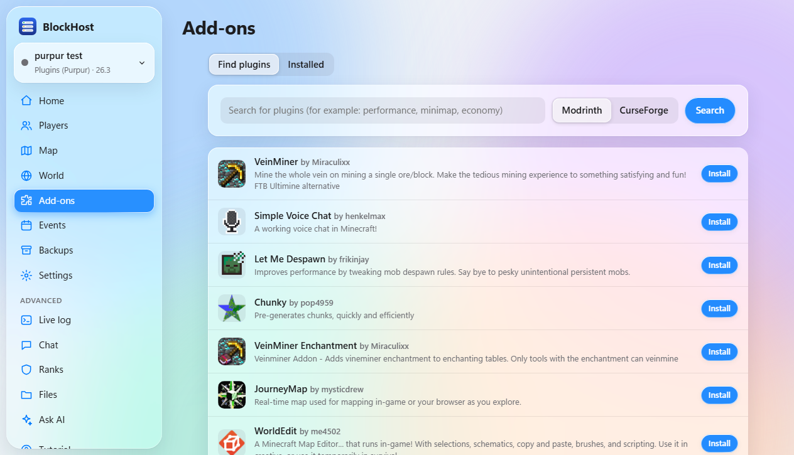</td><td>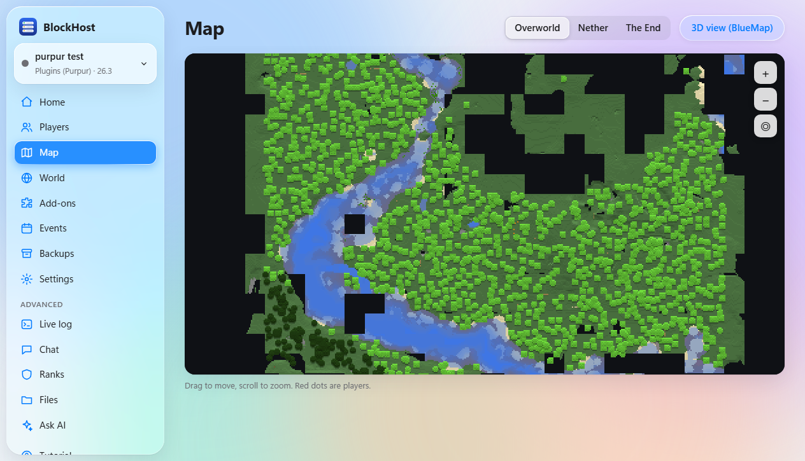</td></tr>
<tr><td>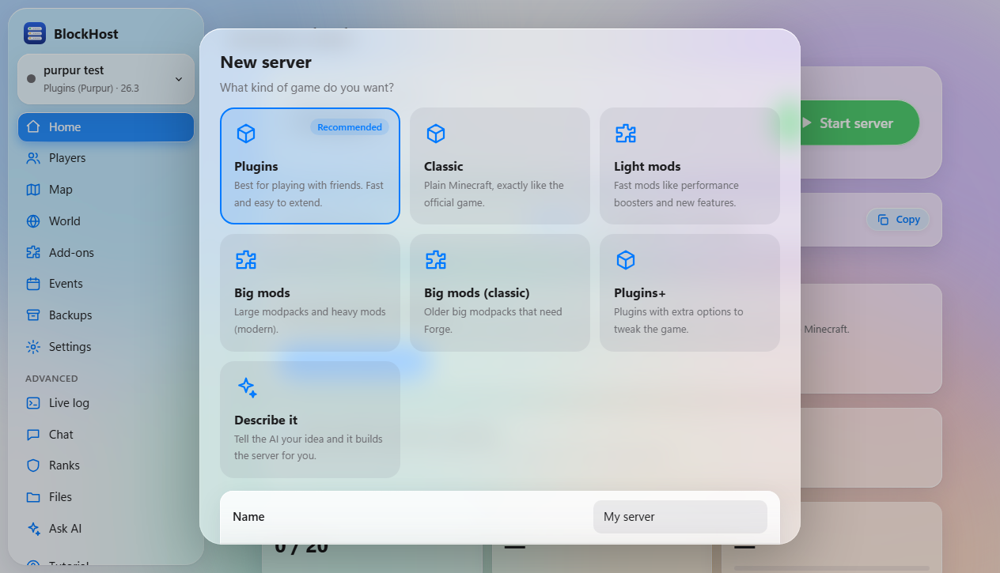</td><td>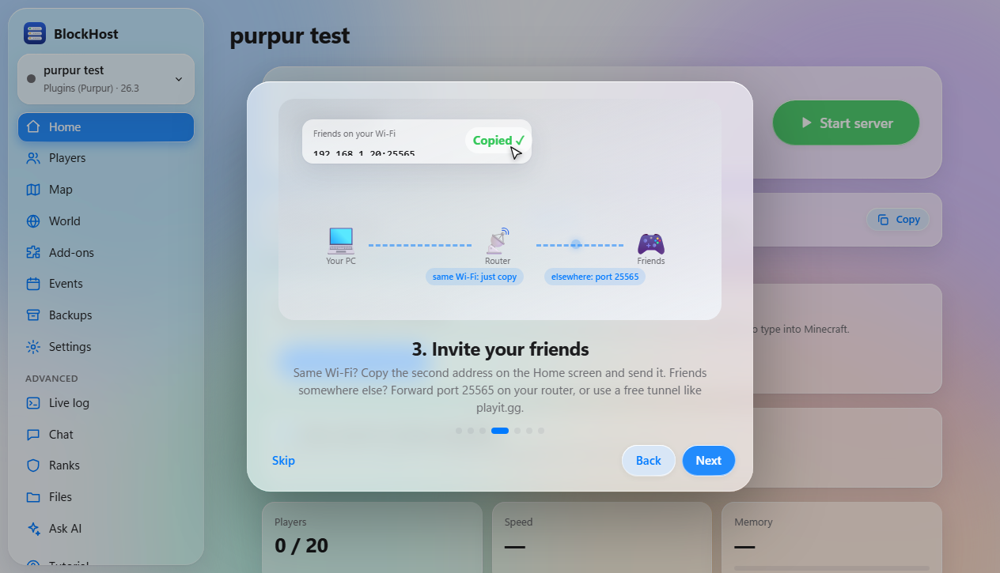</td></tr>
<tr><td>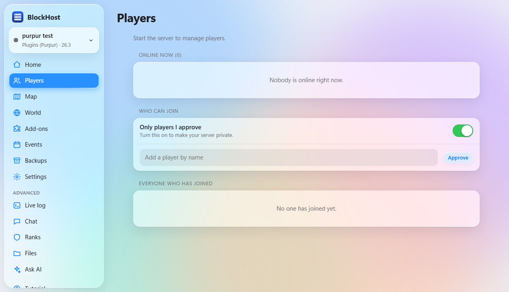</td><td>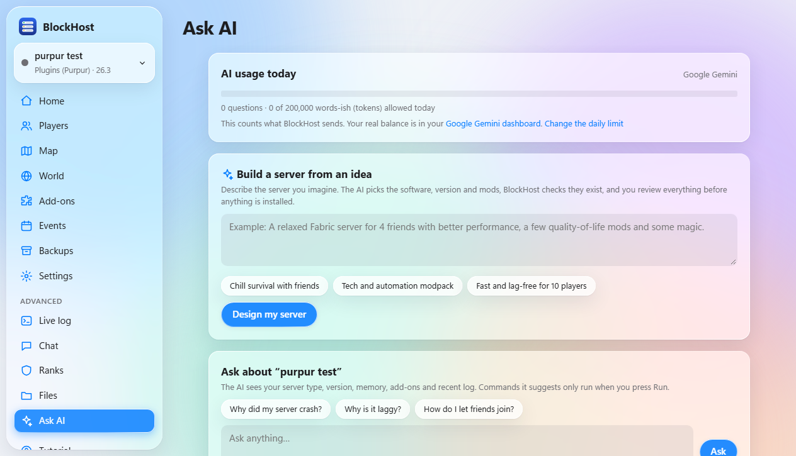</td></tr>
<tr><td>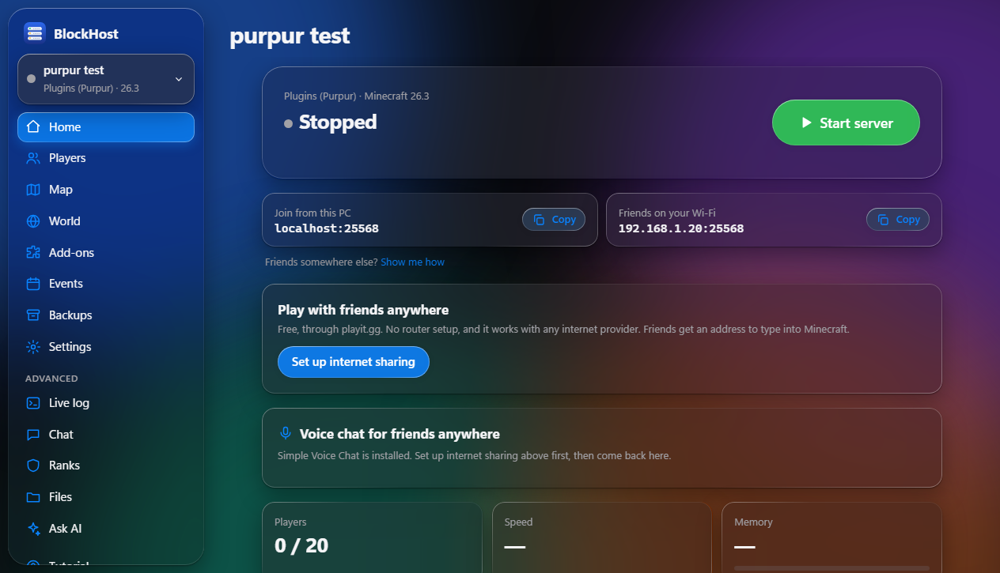</td><td>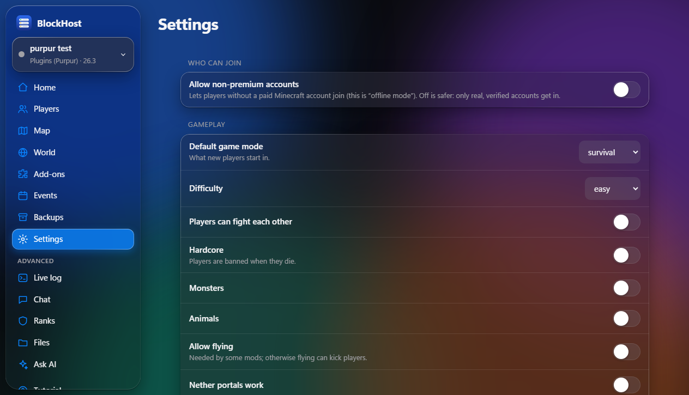</td></tr>
</table>

## Install

1. Download **BlockHost-Setup.exe** from [Releases](https://github.com/grigorehunduu-droid/blockhost/releases/latest) and run it.
   Windows may say the publisher is unknown (the app isn't code-signed yet): click **More info → Run anyway**.
2. Open BlockHost from the Desktop or Start menu, press **Create my first server**, pick a type and accept the Minecraft EULA.
3. Press **Start server**. The Windows Firewall will ask about Java the first time: allow it on private networks.

Prefer no installer? Unzip **BlockHost-portable.zip** into a short folder such as `C:\BlockHost` and run `BlockHost.exe`.
To remove it, use **Settings → Apps → BlockHost**; it asks whether to keep your worlds.

Requires Windows 10 or 11 (64-bit). Everything else (Node.js, Java, the WebView2 runtime) is included or installed for you.

## Privacy and security

- No accounts, no ads, no telemetry. The app only listens on your own PC.
- AI and CurseForge keys are encrypted with your Windows login and only sent to the service they belong to.
- Downloads are checked against their published checksums.
- See [PRIVACY](app/public/legal/privacy.txt) for every service BlockHost talks to, and [SECURITY.md](SECURITY.md) to report a problem.

## Build from source

```powershell
node --test "tests/*.test.js"                              # run the tests
powershell -ExecutionPolicy Bypass -File tools\build.ps1   # builds dist\BlockHost-Setup.exe and the portable zip
```

The build uses only what Windows ships (the .NET Framework C# compiler and `tar`) plus Node.js. It bundles the newest Node.js LTS, runs the tests, and refuses to package anything that looks like an API key, saved settings or user data.

The backend is plain Node.js with no npm dependencies (`app/`), the window is a small WebView2 host (`tools/launcher.cs`).

## License

MIT, see [LICENSE.txt](LICENSE.txt). Third-party notices: [NOTICES](app/public/legal/notices.txt).
